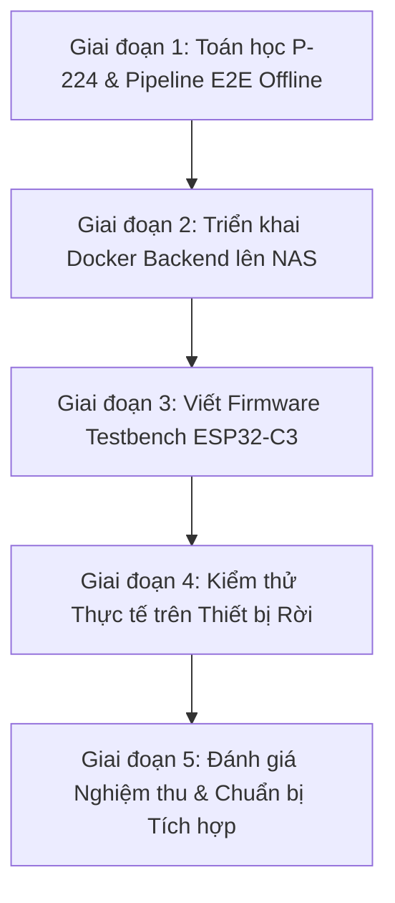

# KẾ HOẠCH TRIỂN KHAI TESTBENCH ĐỘC LẬP: AIRTAG ESP32-C3 & NAS BACKEND (MULTI-USER READY)
> **Mục tiêu:** Xây dựng bộ mã nguồn kiểm thử (Testbench) độc lập 100% để kiểm chứng toàn diện tính năng giả lập Apple AirTag (Find My Network) trên ESP32-C3 SuperMini kết hợp máy chủ NAS Backend (Anisette v3, Giải mã P-224, GraphHopper Routing) trước khi tích hợp vào hệ thống Smartkey chính.  
> **Định hướng kiến trúc:** Chuẩn bị sẵn sàng cho quy mô nhiều người dùng (Multi-User Ecosystem), tối ưu hóa thời lượng bình ắc quy xe máy và loại bỏ độ trễ kết nối BLE.  
> **Nguyên tắc an toàn (Zero Touch):** Tuyệt đối KHÔNG can thiệp, KHÔNG sửa đổi bất kỳ dòng mã nào trong `firmware/esp32 c3/src/main.cpp` hoặc Android App chính.  
> **Phiên bản:** v2.0-Production-Testbench  
> **Ngày cập nhật:** 2026-10-10  

---

## 1. MỤC TIÊU & CÁC CẢI TIẾN TRỌNG TÂM ĐƯỢC ĐƯA VÀO TESTBENCH

1. **Kiểm thử độc lập cách ly (Isolated Sandbox):**
   - Mọi mã nguồn kiểm thử ESP32-C3 nằm riêng tại `firmware/esp32 c3/test/test_airtag/test_airtag.cpp` với cấu hình môi trường biên dịch riêng `[env:test-airtag]` trong PlatformIO.
   - Mọi mã nguồn máy chủ nằm trong `tools/airtag_testbench/`.
2. **Cơ chế phát sóng BLE theo sự kiện (State-Driven BLE Transition):**
   - Không dùng cơ chế xen kẽ cứng (3s/1s) gây trễ mở xe.
   - Trạng thái xe Khóa/Đỗ: Phát 100% Apple AirTag Beacon ($1500\text{ ms} - 2000\text{ ms}$) tiết kiệm pin.
   - Khi có ngắt chạm vân tay R503 (Touch Wake) hoặc kích hoạt mở xe: Lập tức ngắt AirTag, chuyển $100\%$ sang BLE Connectable với tần suất cao (40ms) để điện thoại kết nối tức thì trong $0.2\text{s}$.
3. **Bảo vệ bình ắc quy xe (Battery-Safe Guard):**
   - Giãn Advertising Interval từ 320ms lên $1500\text{ ms} - 2000\text{ ms}$ $\rightarrow$ Giảm dòng tiêu thụ trung bình từ ~25mA xuống dưới $3 - 5\text{ mA}$.
   - Tích hợp kiểm tra điện áp bình qua ADC: Tự động ngắt phát beacon khi bình $< 11.8\text{V}$.
4. **Kiến trúc Multi-User & An toàn bảo mật:**
   - Quản lý theo `device_id` độc lập; Private Key mã hóa tại Database server.
   - Chuẩn bị cơ chế Batch Fetching từ Apple qua Anisette v3 container để tránh bị Apple Rate-Limit khi có nhiều thiết bị.
   - Cơ chế Rolling Key (xoay khóa 24h) chống cảnh báo theo dõi "AirTag Found Moving With You".

---

## 2. CẤU TRÚC CÂY THƯ MỤC HỆ THỐNG TESTBENCH

```text
Tysmartkey/
├── docs/
│   ├── airtag_esp32_c3_server.md          # Đặc tả kiến trúc kỹ thuật chi tiết
│   └── airtag_testbench_plan.md           # Kế hoạch hành động tổng thể này
│
├── firmware/esp32 c3/
│   ├── platformio.ini                     # Thêm môi trường [env:test-airtag] (Giữ nguyên env chính)
│   ├── src/main.cpp                       # [GIỮ NGUYÊN 100% - ZERO TOUCH]
│   └── test/
│       └── test_airtag/
│           └── test_airtag.cpp            # Testbench Firmware: BLE Beacon + Event Transition + OTA Key
│
└── tools/
    └── airtag_testbench/                  # Testbench Backend & Pipeline kiểm thử
        ├── requirements.txt               # cryptography, fastapi, httpx, uvicorn
        ├── docker-compose.yml             # Container Anisette v3 (:6969) + FastAPI Backend (:8000)
        ├── crypto_engine.py               # NIST P-224 (secp224r1): Sinh key, dựng 31-byte frame, giải mã GPS
        ├── backend_testbench.py           # RESTful API (KeyGen, Export-OTA, Batch-Fetch Apple, GraphHopper)
        ├── test_pipeline.py               # Script kiểm thử E2E tự động từ toán học đến định tuyến
        └── README_TESTING.md              # Sổ tay hướng dẫn chi tiết các bước vận hành thực tế trên NAS
```

---

## 3. LỘ TRÌNH 5 GIAI ĐOẠN TRIỂN KHAI (STEP-BY-STEP EXECUTION ROADMAP)



### Giai đoạn 1: Bộ công cụ Toán học Mật mã P-224 & Pipeline Tự động Offline
* **Vị trí:** `tools/airtag_testbench/`
* **Công việc thực hiện:**
  1. Tạo `requirements.txt`: `cryptography>=41.0.0`, `fastapi>=0.104.0`, `uvicorn>=0.23.0`, `httpx>=0.25.0`, `requests>=2.31.0`.
  2. Viết `crypto_engine.py`:
     - Triển khai thuật toán $secp224r1$: Sinh Private Key ($28\text{ bytes}$) & Public Key điểm $X$ ($28\text{ bytes}$).
     - Tính toán Static Random MAC: $\text{MAC}[0] = \text{PK}[0] \mid 0\text{xC0}$, $\text{MAC}[1..5] = \text{PK}[1..5]$.
     - Dựng chính xác khung gói tin thô $31\text{ bytes}$ Apple Offline Finding:
       `0x1E, 0xFF, 0x4C, 0x00, 0x12, 0x19, 0x00, PK[6..27], ((PK[0] >> 6) & 0x03), 0x00`.
     - Hàm giải mã gói tin Apple Find My: ECDH P-224 Shared Secret + KDF SHA-256 + AES-GCM-128 để giải mã vĩ độ, kinh độ, độ chính xác và timestamp.
  3. Viết `test_pipeline.py`:
     - Giả lập sinh khóa $\rightarrow$ Giả lập gói tin BLE $\rightarrow$ Giả lập iPhone mã hóa GPS $\rightarrow$ Giải mã và so khớp tọa độ gốc $\rightarrow$ Gọi mô phỏng GraphHopper tính đường đi.
* **Tiêu chí nghiệm thu (Check):**
  - Chạy `python tools/airtag_testbench/test_pipeline.py` đạt **100% PASS** trên máy tính nội bộ.

---

### Giai đoạn 2: Triển khai Dịch vụ Backend & Docker Compose lên Máy chủ NAS
* **Thông số kết nối NAS:**
  - Host: `192.168.1.114`
  - User: `nas152` | Port SSH: `22`
* **Công việc thực hiện:**
  1. Viết `backend_testbench.py` (FastAPI):
     - `POST /api/key/generate`: Sinh cặp khóa theo `device_id`, lưu JSON/SQLite bảo mật.
     - `GET /api/key/export-ota/{device_id}`: Xuất luồng nhị phân 28 bytes để nạp BLE OTA.
     - `POST /api/reports/fetch/{device_id}`: Kết nối Anisette lấy headers xác thực Apple, gọi API Apple iCloud `/acsnservice/fetch`, giải mã tọa độ trả về JSON.
     - `GET /api/route/to-bike`: Nhận tọa độ điện thoại và xe, gọi GraphHopper `:8989` trả về Polyline đường đi dẫn đường.
  2. Viết `docker-compose.yml` triển khai 2 service:
     - `anisette`: `dadoum/anisette-v3-server:latest` tại cổng `6969`.
     - `findmy-backend`: FastAPI backend tại cổng `8000`.
  3. Đẩy source code lên NAS và khởi chạy:
     `docker compose up -d`
* **Tiêu chí nghiệm thu (Check):**
  - Truy cập `http://192.168.1.114:8000/docs` hiển thị Swagger UI hoạt động đầy đủ 4 endpoints.
  - Container Anisette `http://192.168.1.114:6969` phản hồi mã xác thực Apple hợp lệ.

---

### Giai đoạn 3: Viết Firmware Testbench ESP32-C3 (`test_airtag.cpp`)
* **Vị trí:** `firmware/esp32 c3/test/test_airtag/test_airtag.cpp` & `platformio.ini`
* **Công việc thực hiện:**
  1. Cấu hình môi trường riêng biệt trong `platformio.ini`:
     ```ini
     [env:test-airtag]
     platform = espressif32
     board = esp32-c3-devkitm-1
     framework = arduino
     build_flags = -DCORE_DEBUG_LEVEL=3
     src_filter = +<../test/test_airtag/test_airtag.cpp>
     ```
  2. Triển khai logic trong `test_airtag.cpp`:
     - Quản lý NVS Flash qua `Preferences.h` (`namespace: "airtag_cfg"`, `key: "pub_key"`).
     - Khởi tạo BLE GAP API:
       + **Trạng thái PARKED (Mặc định):** Gán Static Random MAC, phát khung 31 bytes Apple Beacon với interval $1500\text{ ms}$, công suất TX $+20\text{ dBm}$.
       + **Trạng thái CONNECTABLE (Khi kích hoạt nút nhấn giả lập WAKE):** Tức thời ngắt Beacon, gán Public MAC mặc định, mở Custom GATT Service UUID `0xFFE0` / Characteristic `0xFFE1` (Write).
       + **Cơ chế nạp Key OTA:** Khi ghi 28 bytes vào `0xFFE1`, tự động lưu vào NVS Flash và reload lại bộ phát Beacon ngay lập tức.
     - Serial Monitor (115200 bps): Xuất thông tin chi tiết địa chỉ MAC, chế độ phát, RAM trống, và log nhận OTA.
* **Tiêu chí nghiệm thu (Check):**
  - Chạy `pio run -e test-airtag` biên dịch thành công 100%.
  - Lệnh `pio run -e esp32-c3` (firmware chính) vẫn hoạt động hoàn toàn độc lập, không bị ảnh hưởng.

---

### Giai đoạn 4: Kiểm thử Thực tế trên Phần Cứng Rời & Mạng Lưới Apple Thật
* **Công việc thực hiện:**
  1. Nạp `test_airtag.cpp` vào 01 mạch ESP32-C3 SuperMini rời (cắm nguồn USB/Pin dự phòng độc lập, không gắn vào xe).
  2. Dùng App **nRF Connect for Mobile** trên điện thoại:
     - Quét và bắt gói tin quảng bá `Manufacturer Specific Data (0x004C)` chuẩn Apple AirTag.
     - Kích hoạt chế độ Connectable $\rightarrow$ Kết nối vào Service `0xFFE0` $\rightarrow$ Nạp thử 28 bytes Public Key mới $\rightarrow$ Xác nhận ESP32 lưu NVS và phát lại Beacon với MAC mới.
  3. Mang ESP32-C3 ra khu vực công cộng có người dùng iPhone đi qua (hoặc để gần một iPhone không đăng nhập Apple ID quản trị).
  4. Sau 15 - 30 phút: Gọi API `POST /api/reports/fetch/{device_id}` trên NAS để kiểm tra báo cáo tọa độ thật từ Apple iCloud trả về.
  5. Gọi API `GET /api/route/to-bike` để kiểm tra GraphHopper vẽ đường đi tìm đến vị trí ESP32.
* **Tiêu chí nghiệm thu (Check):**
  - Tọa độ giải mã từ Apple phản hồi khớp với vị trí thực tế của mạch ESP32-C3 (sai số $< 15\text{m}$).
  - Đồ thị đường đi của GraphHopper dẫn chính xác tới vị trí thiết bị.

---

### Giai đoạn 5: Tổng Kết Đánh Giá & Kế Hoạch Tích Hợp Vào Smartkey Chính
* **Công việc thực hiện:**
  - Đo dòng tiêu thụ tĩnh thực tế của mạch ESP32-C3 khi phát Beacon $1500\text{ ms}$.
  - Đánh giá độ ổn định của container Anisette và Apple ID sau 7 ngày chạy liên tục.
  - Lập tài liệu đặc tả bản cập nhật lớn (Big Update) để tích hợp an toàn vào `src/main.cpp` của xe máy và App Android.

---

## 4. CHECKLIST BẢO MẬT & NGUYÊN TẮC AN TOÀN TUYỆT ĐỐI

- [x] **Zero Touch:** Không chạm vào mã nguồn xe máy `main.cpp` khi chưa nghiệm thu 100% Giai đoạn 4.
- [x] **Zero Conflict:** Firmware test nằm riêng trong thư mục `test/test_airtag/`.
- [x] **Zero Leak:** Private Key của người dùng không bao giờ lưu trên thiết bị ESP32 (chỉ lưu duy nhất Public Key 28 bytes).
- [x] **Burner Account:** Chỉ sử dụng tài khoản Apple ID thử nghiệm độc lập trên NAS.
- [x] **Battery Safety:** Thiết kế interval $1500 - 2000\text{ ms}$ để bảo toàn ắc quy xe.
